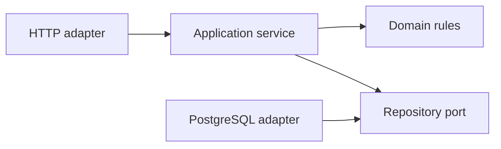

# Architecture and phase boundary

One Go process, one PostgreSQL database, explicit module ownership. HTTP adapters call application services; services enforce function/resource/project authorization and own transactions; domain code owns invariants; repository interfaces point inward and pgx implementations stay in infrastructure. No shared mutable business repository or generic workflow scripting engine.

Only system transport, configuration and database connection infrastructure exist today. No authentication bypass or fake business implementations. Future module directories are deliberately not created until there is implementation to own: organization, projects, locations, units, catalog, assets, assetmovements, imports, inventory and reports. Cross-module work goes through application services with a single explicit transaction boundary; asynchronous side effects require a durable commit/outbox decision first.

## Current repository layout

- `cmd/api`: composition, signal handling and process lifecycle.
- `internal/platform/config`: typed configuration and redacted validation.
- `internal/platform/db`: bounded pgx pool, no domain repositories.
- `internal/platform/httpx`: probes, local documentation and transport limits.
- `api`: embedded OpenAPI source and Scalar shell.
- `db/migrations`: versioned infrastructure probe only.
- `deployments/local`: loopback PostgreSQL and migration tool.
- `tests/integration`: opt-in real PostgreSQL tests.
- `scripts`: network smoke checks.
- `bruno`: manual probe requests, no credentials.
- `tools`: pinned and locked OpenAPI lint tooling.
- `.github/workflows`: proposed CI foundation; never executed here.
- `docs`: architecture, ADRs, database runbook, requirements and evidence.

## Configuration, errors and observability

Environment-only runtime config; immutable validated values passed to components. JSON slog emits lifecycle and method/status/duration/request ID, without URLs, headers, payloads, credentials, driver errors or untrusted correlation IDs. Health responses intentionally expose no DB details. Error envelopes use snake_case and explicit codes. No business auditing, metrics, tracing backend, auth, rate limiter, uploads or jobs exist in Phase 0. No mutation endpoint exists to require project authorization in this phase.

Readiness checks connectivity, not complete schema compatibility; later schema readiness must compare an expected migration version before business traffic. DB outage keeps liveness available. Request/response/header timeouts are bounded. Shutdown drains requests before pool close. Large business bodies, panic recovery, request rate controls and scoped audit middleware must be designed with their actual handlers, before exposing business APIs.

## Review findings

No baseline functional contradictions identified. The logical ERD is explicitly a proposal, so Phase 0 does not create those tables. Optional Hurl is replaced by a small real-network Python smoke command in Phase 0, leaving Go tests primary. `go vet` plus `gofmt` is the initial lint baseline; dedicated staticcheck/govulncheck adoption remains a CI hardening item. A reversible infrastructure probe resolves migration-tool verification without prematurely implementing Phase 1 entities. ADR recommendations never authorize later phases or change approved invariants.

## Dedicated local database follow-up

ADR 0011 supersedes the initial PostgreSQL 18/local-owner setup with isolated PostgreSQL 17.11, separate bootstrap/migration/runtime credentials, guarded disposable-database rollback, secret-safe environment tooling and host acceptance runner. `cmd/dbcheck` verifies actual host-path authentication and role restrictions when built on an unrestricted host. Current sandbox cannot execute those real infrastructure checks; preparation is not connectivity proof.

`tools/go.mod` is a module-discovery boundary only: npm dependencies may contain third-party Go fixtures, which must not be treated as backend packages by `go test ./...`. It adds no runtime dependency or application behavior.
